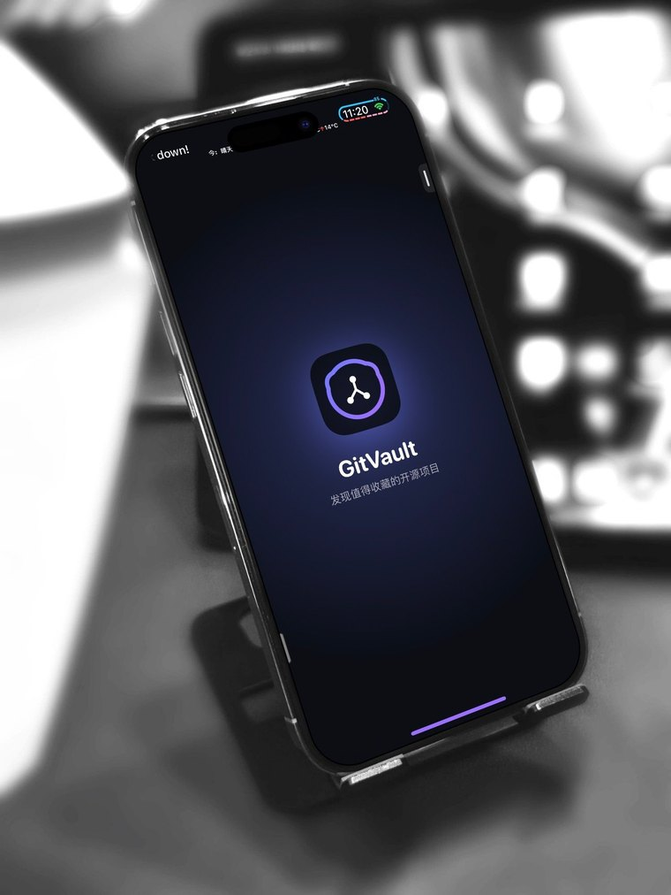
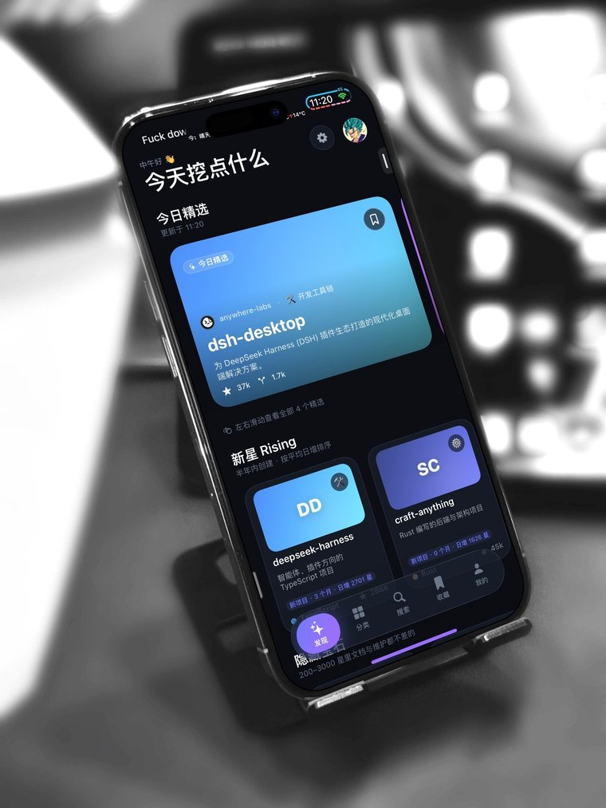
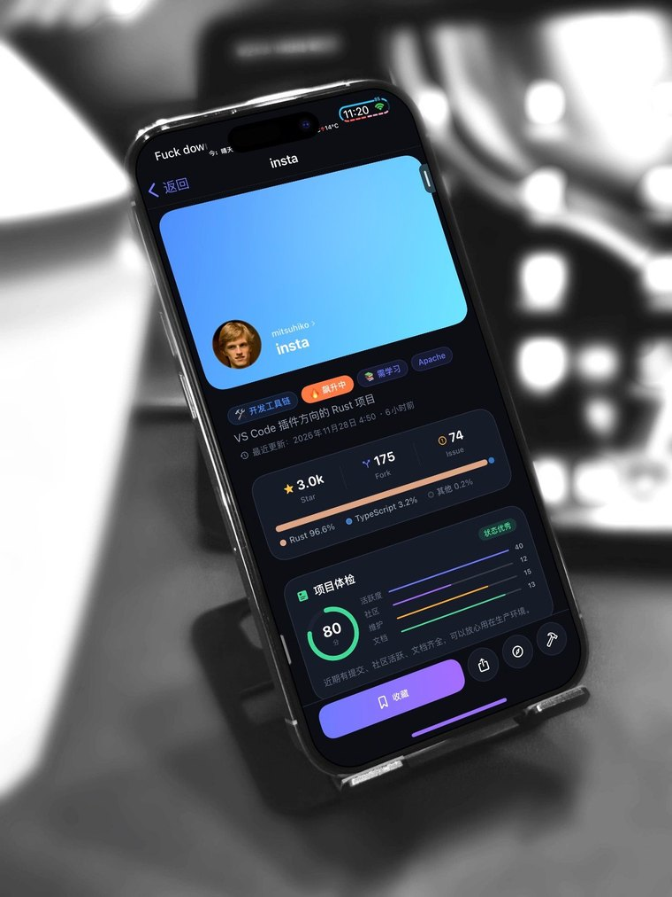
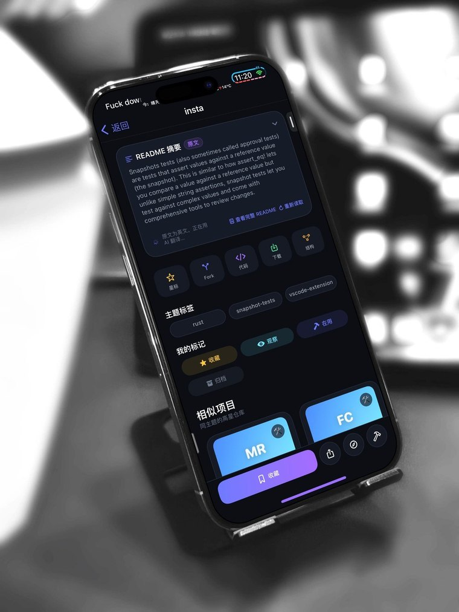
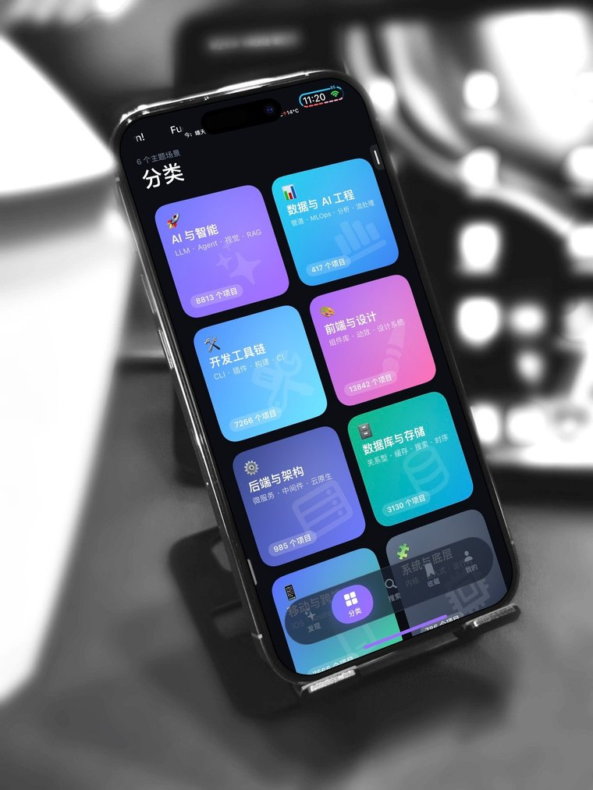
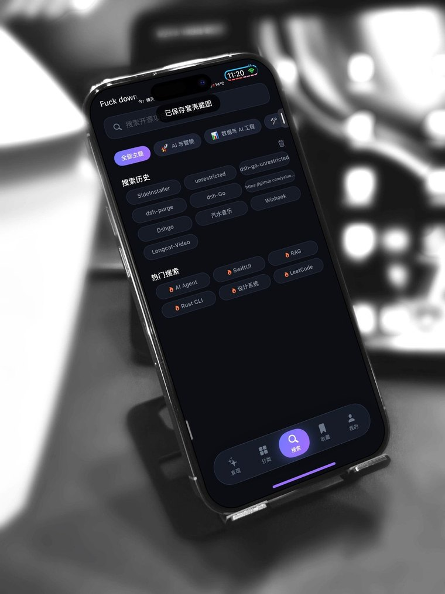
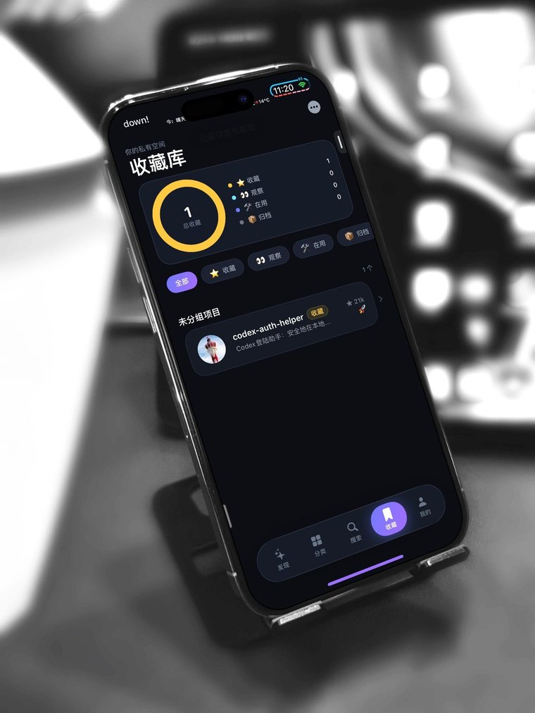
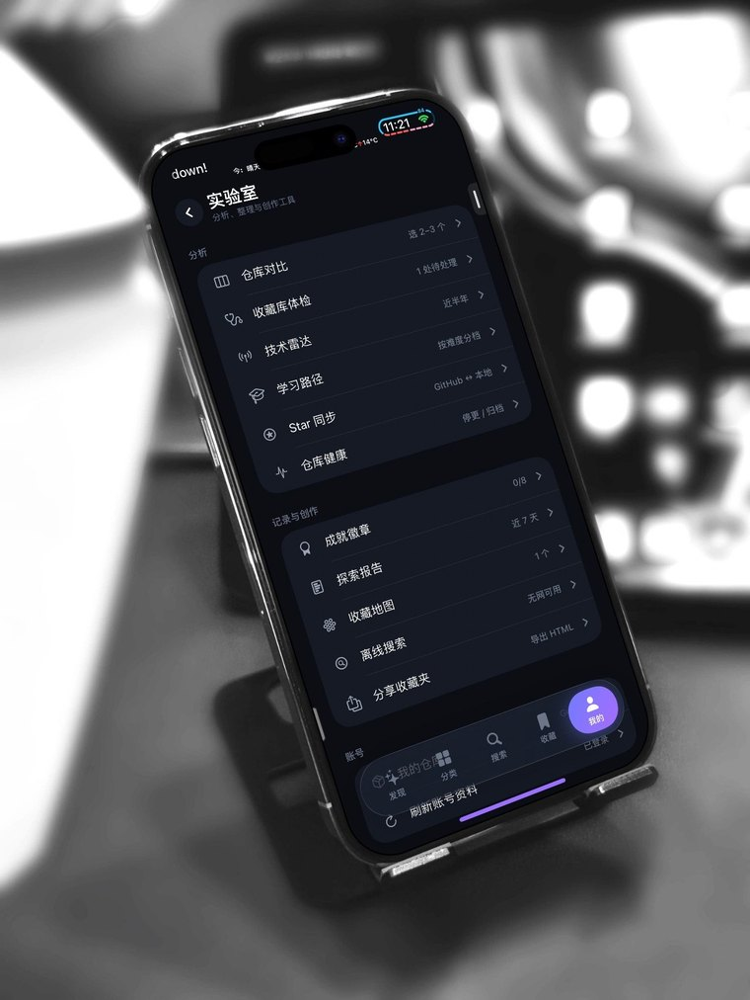
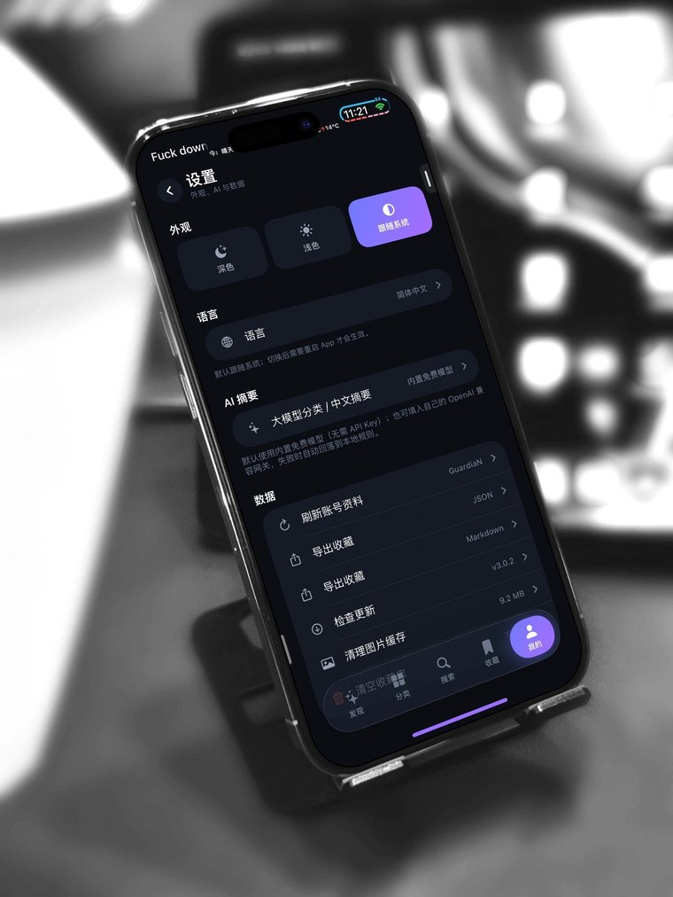

# GitVault

**发现值得收藏的开源项目**

把 GitHub 上散落的 star，变成一套可检索、可维护的资料库。

 

[下载最新版](https://github.com/yfgqh/gitvault/releases/latest) · [更新日志](https://github.com/yfgqh/gitvault/releases) · [Telegram 群](https://t.me/GitVaultipa)

---

## 这是什么

GitHub 上找项目不难，难的是**记住自己收藏了什么、为什么收藏**。

GitVault 是一个 iOS 客户端，做的事很具体：

- 帮你从 GitHub 上捞出**还值得一看**的仓库，而不是只按 star 排序；
- 给你一套**分类 + 标记 + 笔记**的结构，让收藏不再是垃圾桶；
- 把 README 变成**中文摘要**，几秒钟判断这东西到底能不能用；
- 让你**离线也能查**自己存过什么。

IPA 只有 2.7 MB，没有任何第三方依赖，没有广告和埋点。

## 界面

<table>
  <tr>
    <td align="center"> <b>发现</b> · 今日精选 / 新星 Rising</td>
    <td align="center"> <b>详情</b> · 项目体检 / 语言构成</td>
    <td align="center"> <b>简介</b> · README 摘要与标签</td>
  </tr>
  <tr>
    <td align="center"> <b>分类</b> · 10 个主题场景</td>
    <td align="center"> <b>搜索</b> · 历史与热门</td>
    <td align="center"> <b>收藏库</b> · 四态标记与统计</td>
  </tr>
  <tr>
    <td align="center"> <b>实验室</b> · 分析 / 记录 / 创作</td>
    <td align="center"> <b>设置</b> · 外观 / 语言 / AI</td>
    <td align="center"> <b>启动页</b></td>
  </tr>
</table>

## 功能

### 发现

不只看 star 数，而是按几个维度综合打分：

- **今日精选**：当天最值得看的几个项目，横滑浏览；
- **新星 Rising**：半年内创建、按日均增星排序，专门找黑马；
- **持续维护 / 文档齐全**：给"能直接用"的项目单独排一档；
- **契合你的收藏**：根据你已收藏的语言与主题推荐。

### 分类与搜索

- 10 个主题场景：AI 与智能、数据与 AI 工程、开发工具链、前端与设计、后端与架构、数据库与存储、移动与跨端、系统与底层、安全与隐私、学习与资源；
- 每个主题下有二级子分类；
- 搜索支持按 Star / Fork / 最近更新排序，保留搜索历史与热门词。

### 详情

- **项目体检**：从活跃度、社区、维护、文档四个维度打分，一句话结论告诉你"能不能上生产"；
- **语言构成**：真实占比条，不是单一主语言；
- **README 摘要**：结构化抽取（项目定位 + 功能要点），英文内容自动翻译成中文，带译文缓存；
- **相似项目**：同主题的高星仓库，横向扩展视野；
- **快捷操作**：星标、Fork、看代码结构、下载 Release、分享。

### 收藏库

- **四态标记**：收藏 / 观察 / 在用 / 归档，对应不同的使用阶段；
- **自定义文件夹** + 拖拽排序；
- **个人笔记**：记录"为什么收藏它"；
- 一键导出 JSON / Markdown，或生成可分享的 HTML 页面；
- 数据全部保存在设备本地。

### 实验室

| 工具 | 作用 |
| --- | --- |
| 仓库对比 | 最多三个仓库并排比较指标与健康分 |
| 收藏库体检 | 找出长期未更新、issue 积压、缺许可证的项目 |
| 技术雷达 | 近半年新项目的主题分布，看技术往哪走 |
| 学习路径 | 按难度分三档给候选清单 |
| Star 同步 | GitHub starred ↔ 本地收藏双向同步 |
| 仓库健康 | 每周扫描收藏，标记归档与停更项目 |
| 成就徽章 | 收藏习惯的量化 |
| 探索报告 | 最近 7 天的收藏变化 |
| 收藏地图 | 按主题聚类的可视化 |
| 离线搜索 | 无网络时检索已缓存的 README |
| 分享收藏夹 | 导出成 HTML 供他人浏览 |

### 其他

- **英文界面**：660+ 条文案，跟随系统语言，也可在设置里手动切换；
- **自动更新**：每次启动检查新版本，有更新时弹卡直接下载 IPA；
- **深色优先**：默认深色，支持浅色与跟随系统；iPhone / iPad 自适应。

## 安装

GitVault 提供**未签名 IPA**，需要自行安装：

| 方式 | 说明 |
| --- | --- |
| **TrollStore** | 推荐。iOS 14.0–17.x，装上即可永久使用，无需续签 |
| AltStore / Sideloadly | 需要每 7 天重签一次（免费开发者账号限制） |

下载地址：[Releases](https://github.com/yfgqh/gitvault/releases/latest)

最低系统要求：**iOS 16.0**

## 技术栈

| 项 | 说明 |
| --- | --- |
| UI | SwiftUI（无 UIKit 手写页面） |
| 最低版本 | iOS 16.0 |
| 架构 | MVVM + `ObservableObject` |
| 数据源 | GitHub REST API v3 |
| 持久化 | 本地 JSON（无 CoreData / SwiftData） |
| 网络 | `URLSession`，无第三方库 |
| 依赖 | **0**（不引入任何 SPM 包） |
| 体积 | IPA 2.7 MB，其中 96% 是编译后的代码 |

零依赖是刻意的选择：没有 SDK 初始化、没有资源解压，启动快、体积小、老设备也不卡。

## 隐私

- **没有账号系统**：GitHub 令牌只存在本机 Keychain，不经过任何服务器；
- **没有埋点与广告**：不采集设备信息，不上报使用行为；
- **数据本地优先**：收藏、笔记、文件夹全部存在沙盒内，可随时导出或清空；
- **网络请求只有两处**：`api.github.com`（拉取仓库数据），以及你自己配置的 AI 网关（用于翻译，默认使用内置免费端点）。

## 常见问题

<b>必须登录 GitHub 吗？</b>

浏览、搜索、收藏都可以在未登录状态下使用。登录后 API 额度从 60 次/小时提升到 5000 次/小时，并且能使用 Star 同步与私有仓库相关功能。

<b>为什么 App 只有 2.7 MB？</b>

因为里面只有代码：没有图片素材、没有自定义字体、没有音频、没有第三方 SDK。界面上的图标全部来自 SF Symbols，视觉靠 SwiftUI 的渐变与圆角完成。

<b>AI 翻译需要付费吗？</b>

默认使用内置的免费模型，无需 API Key。也可以填入自己的 OpenAI 兼容网关。模型不可用时会回落到本地规则摘要，始终有内容可读。

<b>数据会同步到其他设备吗？</b>

不会。收藏与笔记只存在本机。跨设备迁移请使用「导出收藏」（JSON / Markdown）再导入。

## 更新记录

每个版本的改动都写在 [Releases](https://github.com/yfgqh/gitvault/releases) 里，App 内也会在启动时检查更新。

## 声明

- 数据来源 [GitHub REST API v3](https://docs.github.com/rest)；
- 本项目与 GitHub 官方**无隶属关系**，所有项目内容版权归原作者所有；
- 应用内展示的 README、描述、图标均来自对应仓库，仅作索引与预览用途。

---

**GitVault** · 由 [@yfgqh](https://github.com/yfgqh) 维护

Made with SwiftUI · No tracking · No ads

