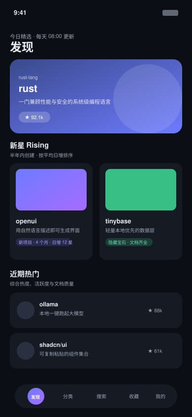
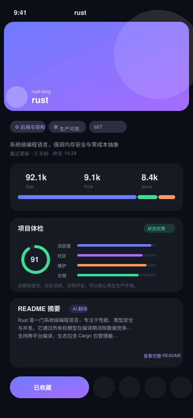
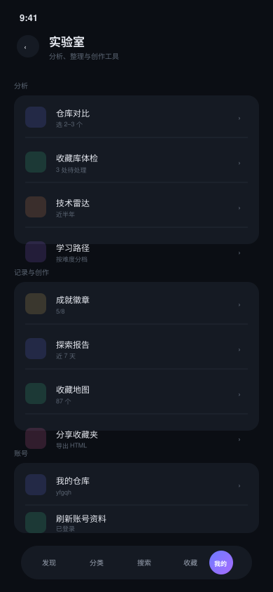
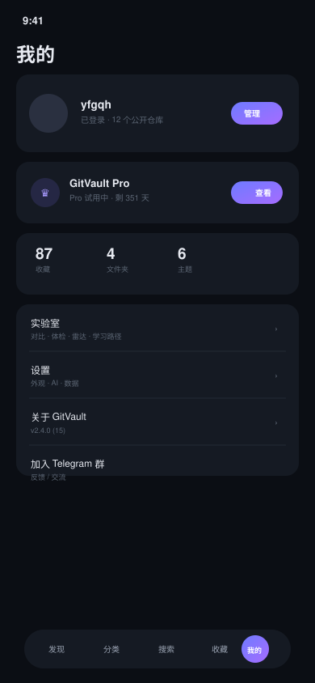

# GitVault · GitHub 精选

为中文开发者打造的开源项目**发现 · 分类 · 收藏 · 追踪**工具。

原生 SwiftUI 编写，深色为默认外观，收藏数据全部保存在本地，不上传任何内容。

<p>
  <b>iOS 16.0+</b> · <b>SwiftUI</b> · <b>零第三方依赖</b> · <b>未签名 IPA（TrollStore / 自签）</b>
</p>

---

## 截图

| 发现 | 详情 | 实验室 | 我的 |
| :--: | :--: | :--: | :--: |
|  |  |  |  |

> 截图为界面结构示意（矢量图），实际界面以真机为准。

---

## 它解决什么问题

逛 GitHub 时"看到好项目却存不下来、存下来又找不到"是常态。GitVault 把这条链路收敛成四步：

1. **发现**：不是单纯按星标排序，而是五维评分（热度 / 新鲜度 / 活跃度 / 质量 / 个人相关）分区分发；
2. **分类**：六大主题 + 二级子分类，配合状态、语言、许可、用途四组标签；
3. **收藏**：四态标记（收藏 / 观察 / 在用 / 归档）、自定义文件夹、拖拽排序、个人笔记；
4. **追踪**：项目体检、更新时间、Release 资产下载、代码结构浏览。

半年后再打开，你依然知道每个项目是什么、当初为什么收藏。

---

## 功能清单

### 发现

- **今日精选**：六大主题各取一个，按日期轮换，每天 08:00 更新
- **新星 Rising**：半年内创建、star ≥ 300，按 `star / 存续天数` 排序
- **隐藏宝石**：200–3000 星区间，按文档质量与活跃度排序
- **近期热门**：综合分排序（GitHub 不提供 star 历史，不虚构增速）
- **为你推荐**：基于收藏的 topic 与语言
- 全局去重：同一仓库只出现一次，同作者全页最多 1 个，同分类每区最多 2–3 个
- 卡片显示推荐理由，例如「新项目 · 4 个月 · 日增 12 星」
- 今日考古：随机回顾 30 天前的收藏

### 分类

- 6 大主题 × 4–5 个二级子分类（如「移动与跨端」→ iOS / Android / Flutter / React Native / 鸿蒙）
- 每页 100 条，下滑自动续载（GitHub 搜索上限 1000 条）
- 磁盘缓存：断网也能看上次结果

### 详情

- **项目体检**：0–100 分，拆解活跃度 / 社区 / 维护 / 文档，给一句话结论
- **README**：先展示原文摘录；非中文自动交由 AI 翻译；可打开全文，按 Markdown 原格式渲染（标题、列表、表格、代码块、图片、视频、链接）
- **代码结构**：`git/trees` 拉全树，按目录分组，单文件查看并支持文件内搜索与命中高亮
- **一键星标 / Fork**、下载仓库（优先 Release 资产，多资产可选，无资产回落源码包）
- 最近更新时间、语言占比、相似项目、作者页

### 收藏

- 四态标记、文件夹、拖拽排序、左滑操作
- 个人笔记（长按添加，随导出携带）
- 收藏库体检：停更 / 许可缺失筛查，一键归档
- 仓库对比：选 2–3 个并排比较 7 项指标
- 分享收藏夹：导出为独立 HTML 页面

### 实验室（我的 → 实验室）

- 仓库对比、收藏库体检、技术雷达（近半年主题趋势）、学习路径（入门 / 进阶 / 深入）
- 成就徽章、探索报告、收藏地图、作者页

### 其他

- GitHub 登录：访问令牌（推荐）或 OAuth Device Flow
- AI 摘要：默认内置免费模型（Pollinations，无需 Key），可替换为任意 OpenAI 兼容网关，失败自动回落本地规则
- 在线更新：比对 GitHub Releases 的 tag
- 深色 / 浅色 / 跟随系统，iPhone 与 iPad 自适应

---

## Pro 与免费

一次性 ¥9.9，无订阅、不自动续费。**当前为限时免费试用（365 天）**，点击解锁会提示"目前无需购买"。

| 能力 | 免费 | Pro |
| --- | --- | --- |
| 浏览 / 搜索 / 收藏 / 分类 | ✅ | ✅ |
| README 全文渲染与下载 | ✅ | ✅ |
| AI 翻译 | 每日 20 次 | 无限 |
| 离线全量库（star > 500） | 只读已有缓存 | 自动增量抓取 |
| 批量星标 / 批量 Fork | — | ✅ |
| 代码浏览增强（搜索 + 高亮） | 行号 + 复制 | ✅ |
| 徽章 / 周报 / 主题 | ✅ 全部免费 | — |

核心永远免费：**不会锁收藏，不会锁浏览**。

---

## 技术实现

| 项 | 选型 |
| --- | --- |
| 界面 | SwiftUI，iOS 16.0 起 |
| 持久化 | `Codable` + JSON 原子写入（`VaultStore` / `CategoryCache` / `ExploreCache` / `AllReposStore`），未使用 SwiftData |
| 网络 | `URLSession` + `async/await`，统一错误映射与幂等重试 |
| 图片 | 自建 `NSCache` 加载器，避免 `AsyncImage` 在列表滚动时反复重建 |
| README 渲染 | 自研 Markdown → HTML（约 300 行）+ `WKWebView`，无第三方库 |
| 内购 | StoreKit 2，非消耗型 `com.yfgqh.gitvault.pro` |
| 图形 | 全部 SwiftUI `Canvas` / `Path` 绘制（关系图、收藏地图、评分环） |
| 构建 | XcodeGen（`project.yml` 为唯一事实来源）+ GitHub Actions macOS Runner |
| 依赖 | 无 CocoaPods / SPM 三方依赖 |

### 目录结构

```
GitVault/
├── App/                # 入口、根容器、依赖容器
├── Models/             # DTO、UI 模型、分类与标签
├── Services/           # 网络、鉴权、收藏、AI、发现引擎、缓存、下载
├── ViewModels/         # 首页 / 分类 / 搜索 / 详情 / 代码
├── Features/           # Explore 详情 分类 搜索 收藏 我的 实验室
├── DesignSystem/       # 颜色、字体、间距、通用组件
├── Utils/              # Keychain、崩溃日志、触感、配置
└── Mock/               # 离线示例数据
```

---

## 构建

需要 macOS + Xcode 15 以上、[XcodeGen](https://github.com/yonaskolb/XcodeGen)。

```bash
brew install xcodegen
xcodegen generate
xcodebuild -project GitVault.xcodeproj \
  -scheme GitVault \
  -configuration Release \
  -sdk iphoneos \
  -destination 'generic/platform=iOS' \
  -derivedDataPath build \
  CODE_SIGNING_ALLOWED=NO \
  build
```

生成的 `.app` 放入 `Payload/` 后压缩即可得到未签名 IPA。

### 安装

- **TrollStore**：直接把 IPA 拖进去安装（iOS 14–17）
- **自签工具**（AltStore / Sideloadly / Xcode）：需要自己的证书

> 未签名包无法连接 App Store，因此 Pro 购买会提示"目前无需购买"（当前本就限时免费）。

---

## 版本历史

| 版本 | 重点 |
| --- | --- |
| 2.4.0 | 信息架构整理（主页 / 实验室 / 设置三层）、README 与截图更新 |
| 2.3.0 | 仓库对比、收藏体检、分享 HTML、技术雷达、作者页、学习路径、收藏笔记、批量操作、代码搜索高亮；Pro 分层调整 |
| 2.2.0 | 发现页重设：五维评分、新星 / 隐藏宝石 / 近期热门三条流、全局去重、推荐理由、整页缓存 |
| 2.1.x | 详情页溢出修复、README 全文渲染、分类分页、下载二选一与资产选择、保存位置选择 |
| 2.0.x | 降级到 iOS 16、移除 SwiftData、修复启动崩溃 |
| 1.x | 骨架、数据层、核心页、搜索收藏、登录与打磨 |

---

## 已知限制

- **全量抓取**：GitHub 搜索单查询最多返回 1000 条，只能按星标区间分桶逐步逼近，无法一次拉完
- **飙升榜**：GitHub 不提供 star 历史，改用「综合分 + 近期创建」，命名已改为「近期热门」
- **小组件**：需要独立的 Widget Extension 与 App Group，未签名包无法挂载，暂未提供
- **推送提醒**：需要 APNs 与服务端，目前仅提供「作者页」，不含通知推送

---

## 声明

数据来源 GitHub REST API v3。本项目与 GitHub 官方无隶属关系，所有项目内容版权归原作者所有。

反馈与交流：[Telegram 群](https://t.me/GitVaultipa)
